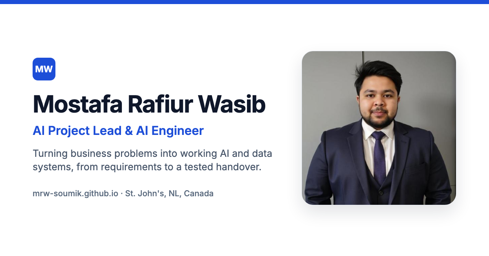

# mrw-soumik.github.io

Source for the portfolio of **Mostafa Rafiur Wasib**, AI Project Lead and AI Engineer in St. John's, Newfoundland and Labrador.

**Live site:** https://mrw-soumik.github.io

## What is in this repository

| Path | Purpose |
|---|---|
| `index.html` | Homepage (plain HTML, no build step) |
| `resume.html`, `assets/resume.css` | Printable résumé and the source of the résumé PDF |
| `assets/*.pdf` | Résumé PDF. Two file names are kept identical so older links keep working |
| `*.md`, `_layouts/`, `_includes/` | Academic project pages, rendered by GitHub Pages (Jekyll) with the site layout |
| `assets/styles.css`, `assets/site.js` | Shared styles (light and dark themes) and small progressive-enhancement scripts |
| `_config.yml` | Jekyll settings, plugins (SEO tags, sitemap, redirects) and pages kept unpublished |
| `.github/workflows/site-check.yml` | Builds the site exactly as GitHub Pages does and checks internal links on every pull request |

## Preview locally

- Homepage and résumé: run `python3 -m http.server 8000` in this folder and open http://localhost:8000.
- Markdown and case study pages are rendered by Jekyll. Open a pull request (the Site check workflow uploads the built site as an artifact) or run `bundle exec jekyll serve` with the `github-pages` gem.

## Update the résumé PDF

Edit `resume.html`, then run `scripts/build-cv.sh` (requires Google Chrome). It prints the PDF and refreshes the older file name too.

## Content and licence

The code (HTML, CSS and JavaScript) is available under the MIT licence in `LICENSE`. Written content, images and the résumé are © Mostafa Rafiur Wasib, all rights reserved.

Client case studies are high-level public summaries approved for sharing. They contain no client data, source code or credentials.
